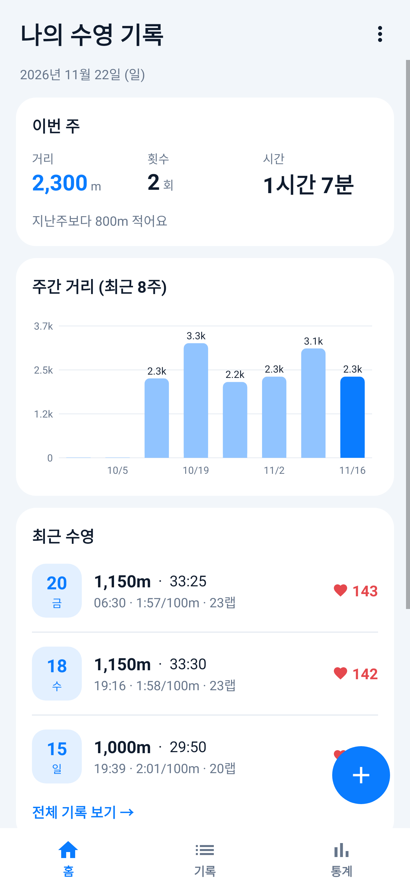
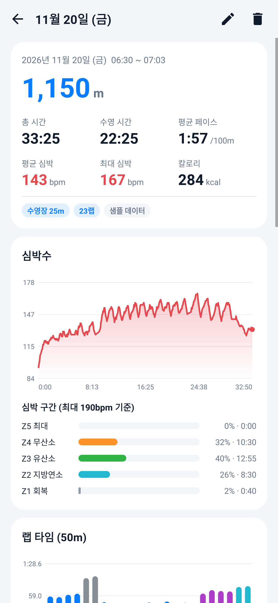
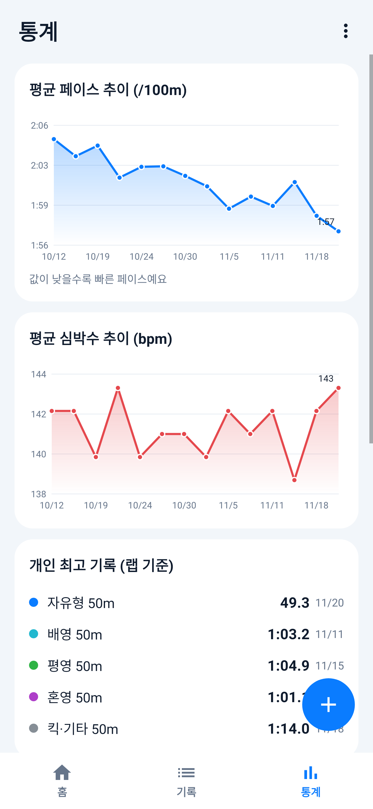
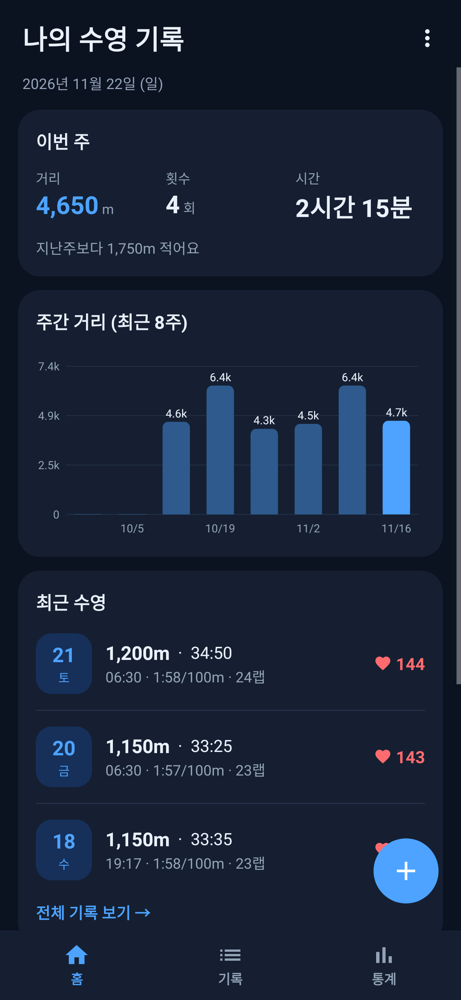

# 나의 수영 기록 (Android)

수영 랩 타임, 심박수, 거리, 페이스를 기록하고 히스토리·통계로 확인하는 안드로이드 앱입니다.

| 홈 | 세션 상세 | 통계 | 다크 모드 |
|---|---|---|---|
|  |  |  |  |

## 기능
- **홈**: 이번 주 거리·횟수·시간, 지난주 대비, 최근 8주 거리 그래프, 최근 수영, 누적 기록
- **기록**: 월별로 묶인 히스토리 (거리 · 시간 · 100m 페이스 · 평균 심박)
- **세션 상세**: 심박수 그래프, 심박 구간(Z1~Z5) 분포, 랩 타임 그래프(영법별 색상), 최고/평균/최저 랩, 페이스 편차, 랩 상세 표(영법·거리·시간·페이스·심박·스트로크·휴식)
- **통계**: 페이스 추이, 평균 심박 추이, 영법·거리별 개인 최고 기록, 영법별 거리 비중, 월별 거리
- **기록 입력**: 날짜/시간, 수영장 길이(25/50m/직접), 랩 추가(반복 횟수로 여러 랩 한 번에), 심박·칼로리·메모
- **Health Connect 가져오기** (Android 14+): 삼성 헬스·갤럭시 워치 등에서 수영 세션, 랩, 영법, 심박수, 거리, 칼로리를 가져옴
- **백업/복원**(JSON), **CSV 내보내기**(엑셀용), 최대 심박수 설정, 샘플 데이터
- 데이터는 기기 안에만 저장 (인터넷 권한 없음)

## 설치
`files/swim-log-1.0.apk` 를 휴대폰에서 받아 설치합니다 (출처를 알 수 없는 앱 허용 필요). Android 8.0 이상.

## 빌드
Gradle/AndroidX 없이 순수 Java + Android 기본 API로 작성되어 SDK 도구만으로 빌드됩니다.
```bash
# 필요: JDK 17+, aapt2, d8 또는 dx, zipalign, apksigner, android.jar(API 34+)
COMPILE_JAR=/path/to/android-35/android.jar ./build.sh
```
서명 키는 `keystore/` 에 생성되며 저장소에는 올리지 않습니다 (`.gitignore`).
